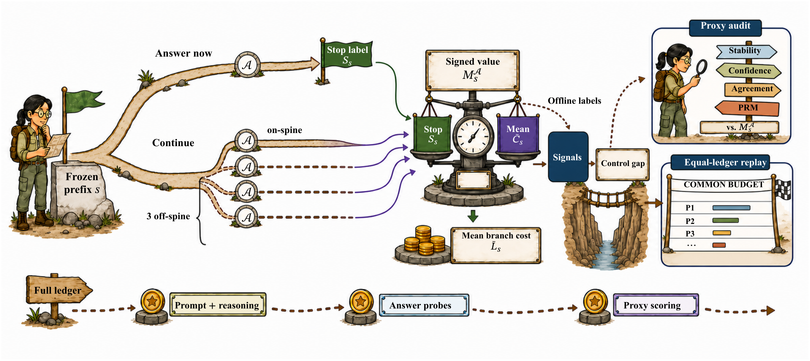

<div align="center">

# FLCVA

### A Full-Ledger Counterfactual Audit of Adaptive Reasoning

**Accepted to EACL 2027 · Main Conference**

Xiaopeng Chu · Wenzheng Kong · Wei Liu · Wenyi Zhang<sup>†</sup>  
University of Science and Technology of China  
<sup>†</sup>Corresponding author: [wenyizha@ustc.edu.cn](mailto:wenyizha@ustc.edu.cn)

[](https://2027.eacl.org/)
[](https://openreview.net/forum?id=ubcaeqHVOy)
[](pyproject.toml)

[Overview](#overview) · [Key findings](#key-findings) · [Quick start](#quick-start) · [Reproduction](#reproduction) · [Citation](#citation)

</div>

> **When is more reasoning worth its cost?** Detecting a wrong answer is only the first step: an adaptive system must also predict whether continuation will help and turn that prediction into better compute allocation.

## Overview

The **Full-Ledger Counterfactual Value Audit (FLCVA)** measures the value of continuing from the same frozen reasoning prefix. It compares answering immediately with four fixed-length continuations, evaluates every endpoint with the same answer procedure, and charges every observation used by an allocation policy.

<p align="center">
  
</p>

The reported value is mean correctness change divided by mean continuation cost, including answer tokens, expressed **per 1,000 logical tokens**. The audit separates three questions:

| Stage | Question | Evaluation |
| :--- | :--- | :--- |
| **Measure** | Does another reasoning block help or hurt? | Paired correctness change from the same prefix |
| **Predict** | Can observable signals identify recoverable errors and vulnerable correct answers? | Held-out recovery and damage prediction |
| **Allocate** | Do those predictions improve the use of a shared budget? | Accuracy–cost gains over a current-wrongness baseline |

## Key findings

The primary study evaluates **Qwen3-8B** and **DeepSeek-R1-Distill-Qwen-7B** on **GSM8K** and **MATH-500**, with an external replication on **DeepSeek-R1-Distill-Llama-8B**.

| Primary model | Recovery of a wrong answer | Damage to a correct answer |
| :--- | ---: | ---: |
| Qwen3-8B | **26.6%** | 1.4% |
| DeepSeek-R1-Distill-Qwen-7B | **18.9%** | 1.9% |

These are single-draw rates for a randomly selected 256-token continuation, conditioned on the current answer being wrong or correct, respectively.

- **Continuation can both repair and damage answers.** More reasoning is useful selectively.
- **Answer persistence carries information beyond current correctness.** Its value as a predictor still needs a separate allocation test.
- **Prediction does not automatically become better control.** Relative to the correctness shortcut, Ridge-M changes normalized AULC by −0.21% on Qwen3 and +0.70% on DeepSeek; the Qwen3 increment is inconclusive. The tested lightweight, myopic controllers show limited continuation-specific gains.

## Quick start

**Python 3.10+ is required.** The CPU mock pipeline lets you check the installation and complete workflow without downloading model weights.

```bash
git clone https://github.com/cxp-ustc/flcva.git
cd flcva

python -m venv .venv
source .venv/bin/activate
python -m pip install --upgrade pip
python -m pip install -r requirements.txt
```

Run all six stages and the tests:

```bash
flcva preflight --config configs/mock.yaml
flcva generate --config configs/mock.yaml
flcva score --config configs/mock.yaml
flcva evaluate --config configs/mock.yaml
flcva replay --config configs/mock.yaml
flcva audit --config configs/mock.yaml
pytest -q
```

Outputs are written under `runs/`. The mock uses synthetic fixtures to exercise the pipeline; its outputs are not the paper's experimental results.

## Reproduction

Model and dataset revisions are pinned in [`configs/frozen.yaml`](configs/frozen.yaml). The primary protocol uses four spines per problem, 256-token checkpoints, four continuation branches, and a common answer operator. Generation is label-blind; gold answers enter at evaluation.

<details>
<summary><strong>Run the primary-model GPU protocol</strong></summary>

Use a CUDA environment compatible with the vLLM version specified in [`pyproject.toml`](pyproject.toml), then install the GPU dependencies:

```bash
python -m pip install -r requirements-gpu.txt
```

Generate and score both primary models:

The example configurations inherit `stage: canary` from
`configs/formal-common.yaml`. Set it to `formal` for a full paper-protocol run;
this enables the frozen-configuration and difficulty-reference checks.

```bash
flcva preflight --config configs/formal-qwen3.yaml --require-gpu
flcva generate --config configs/formal-qwen3.yaml
flcva score --config configs/formal-qwen3.yaml

flcva preflight --config configs/formal-deepseek.yaml --require-gpu
flcva generate --config configs/formal-deepseek.yaml
flcva score --config configs/formal-deepseek.yaml
```

Evaluate each run with the complementary primary run as its difficulty reference, then replay and audit:

```bash
flcva evaluate --config configs/formal-qwen3.yaml \
  --peer-run-dir runs/flcva-deepseek-local
flcva evaluate --config configs/formal-deepseek.yaml \
  --peer-run-dir runs/flcva-qwen3-local

flcva replay --config configs/formal-qwen3.yaml
flcva audit --config configs/formal-qwen3.yaml
flcva replay --config configs/formal-deepseek.yaml
flcva audit --config configs/formal-deepseek.yaml
```

These examples use one shard and the default `runs/` output root. For a distributed campaign, configure `execution.shard_index` and `execution.num_shards`, merge outputs with `flcva merge`, and pass the resulting run paths to evaluation. Full generation requires GPU resources and model downloads.

`FLCVA_MODEL_PATH` and `FLCVA_SCORER_PATH` can point to local model snapshots. Each snapshot must use the pinned commit as its directory name or provide a matching `.flcva_revision` marker.

</details>

<details>
<summary><strong>Render results and explore the analyses</strong></summary>

The primary renderer takes two audited run directories:

```bash
python scripts/render_paper_results.py \
  --qwen-run runs/flcva-qwen3-local \
  --deepseek-run runs/flcva-deepseek-local
```

It writes result macros to `paper/results.tex` and figures and tables to `paper/generated/` by default. See [`REPRODUCIBILITY.md`](REPRODUCIBILITY.md) for the required analysis inputs and repository contents.

- [`paper/analysis/`](paper/analysis/) contains controller decomposition, bootstrap, conditional-information, non-myopic scheduling, and transfer analyses.
- [`paper/ablation/`](paper/ablation/) contains answer-cue and continuation-length robustness analyses.
- [`configs/replication-llama.yaml`](configs/replication-llama.yaml) records the Llama replication campaign; [`scripts/render_llama_replication_results.py`](scripts/render_llama_replication_results.py) renders an audited replication run supplied with `--run-dir`.

Full generated traces and model weights are not bundled. Rendering the scientific results requires the corresponding audited run artifacts; the CPU mock provides an independent installation check.

</details>

## Repository guide

| Path | Contents |
| :--- | :--- |
| [`src/flcva/`](src/flcva/) | Generation, scoring, answer evaluation, ledgers, replay, statistics, and audit checks |
| [`configs/`](configs/) | Frozen protocol, CPU mock, primary-model examples, and replication specification |
| [`data/`](data/) | Public benchmark inputs, deterministic labels, and synthetic smoke fixtures |
| [`scripts/`](scripts/) | Dataset preparation and result rendering |
| [`paper/analysis/`](paper/analysis/) | Prediction and allocation analyses |
| [`paper/ablation/`](paper/ablation/) | Answer-cue and continuation-length studies |
| [`tests/`](tests/) | Parsing, value, accounting, replay, and pipeline checks |

## Citation

If this work informs your research, please cite the paper. The entry below records its EACL 2027 acceptance.

```bibtex
@misc{chu2027flcva,
  title  = {A Full-Ledger Counterfactual Audit of Adaptive Reasoning},
  author = {Chu, Xiaopeng and Kong, Wenzheng and Liu, Wei and Zhang, Wenyi},
  year   = {2027},
  note   = {Accepted to EACL 2027, Main Conference},
  url    = {https://openreview.net/forum?id=ubcaeqHVOy}
}
```

## Contact and usage terms

For research questions, contact [Wenyi Zhang](mailto:wenyizha@ustc.edu.cn). For implementation questions, please [open an issue](https://github.com/cxp-ustc/flcva/issues).

Copyright and usage information is provided in [`RIGHTS.md`](RIGHTS.md). No open-source license is granted. Datasets and model snapshots remain subject to their original providers' licenses and terms.
